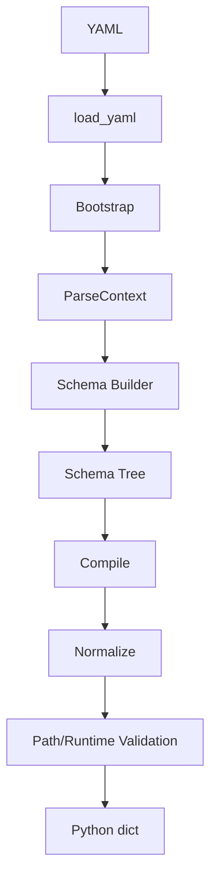

# Parse 重构 Demo 说明与复审记录

## 1. 文档目的

本文档记录 Parse 重构 Demo 的目标、文件职责、测试范围、已知限制、变更编号、回滚方式和后续操作。

本 Demo 使用正式 Parse 模块组织代码，但尚未接入现有 Builder、Trainer、Tester 或 Inferencer。

所有 Demo 性质的代码使用以下标记：

```python
# PARSE_REFACTOR_DEMO:
```

## 2. 当前已经验证的范围

`main/parse/smoke_test.py` 当前执行五个可运行配置：

1. MLM Train；
2. MLM Test；
3. MLM Inference；
4. QA Train；
5. QA Test。

执行命令：

```bash
cd ~/NLP/main/parse
python smoke_test.py
```

Smoke Test 的标准输出是一个 Python `dict`，顶层 key 为：

```python
{
    "mlm_train": ..., 
    "mlm_test": ..., 
    "mlm_inference": ..., 
    "qa_train": ..., 
    "qa_test": ...,
}
```

每个结果都保持对应 YAML 的字段结构。字段值可以经过 Parse 规范化，例如：

- Registry alias 转换成 canonical key；
- YAML list `betas` 转换成 tuple；
- 路径字符串转换成 `pathlib.Path`。

这表示“结构同构、语义规范化”，不是保证每个 Python 原始类型完全不变。

## 3. Smoke Test 配置文件

配置目录：

`main/cfg/smoke_test/`

| 文件 | 覆盖范围 | 是否执行 |
| --- | --- | --- |
| `mlm_train.yaml` | MLM Train、动态组件、Dataset Task Schema、Runtime | 是 |
| `mlm_test.yaml` | MLM Test、Checkpoint、Dataset、Test Metric | 是 |
| `mlm_inference.yaml` | MLM Inference、Decoding、Runtime | 是 |
| `qa_train.yaml` | QA Train、QA 动态组件、Dataset、Metrics | 是 |
| `qa_test.yaml` | QA Test、Checkpoint、Dataset、Test Metric | 是 |
| `qa_inference.yaml` | 未注册 QA Inference 的未来结构记录 | 否 |

`qa_inference.yaml` 不执行，因为当前没有对应的 Task Builder 和 Task Spec。不能为了让测试通过而伪造不存在的任务。

## 4. Parse 流程



### 4.1 Load

`parse/parser.py::load_yaml()` 负责读取 YAML。

PyYAML 延迟导入，保证只导入 Parse 模块时不强制加载 YAML 依赖。

### 4.2 Bootstrap

`parse/bootstrap.py::bootstrap_config()` 负责：

1. 读取根级 `task`；
2. 解析 Task canonical key；
3. 从 Task Spec 获取 Bootstrap descriptor；
4. 扫描动态组件路径；
5. 读取动态组件 `type`；
6. 通过运行 Registry 解析 alias；
7. 通过 Spec Registry 获取 ComponentSpec；
8. 创建 `ComponentSelection`；
9. 生成 `ParseContext`。

当前动态组件范围：

- tokenizer；
- model；
- losses；
- optimizer；
- scheduler；
- metrics；
- inference.decoding。

Dataset、Collator、Runtime 不进入 Bootstrap。

### 4.3 Schema Builder

`parse/schema/builder.py::build_schema()` 根据 Task key 构建根 Schema。

Dataset 不使用 Registry。Dataset 的 `type`、`root`、`splits` 和 `params` 由当前 Task Schema 决定。

Collator 不出现在 YAML，也不进入 Schema。

Runtime 作为普通静态配置处理：

```text
runtime
└── device
    ├── type
    ├── index
    └── count
```

### 4.4 Normalize

Schema normalize 负责：

1. 类型检查；
2. 默认值处理；
3. Registry key canonical 化；
4. 动态组件 params 规范化；
5. 路径字符串转换为 `pathlib.Path`；
6. 返回新配置，不修改原始 raw config。

### 4.5 Validate

`parse/validation/pipeline.py::validate_config()` 负责：

1. Runtime 静态规则；
2. CPU index 约束；
3. CUDA 设备数量约束；
4. 根据 `validate_runtime` 选择是否执行真实环境检查。

## 5. 当前输出结果的解释

Smoke Test 成功输出后，以下结果是预期行为：

### 5.1 `type` 变化

例如：

```yaml
type: cross_entropy
```

规范化后：

```python
"type": "crossentropyloss"
```

这是 Registry alias 到 canonical key 的转换。

### 5.2 路径变化

例如：

```yaml
vocab_file_path: tokenizer/bert_base_chinese_tokenizer/vocab.txt
```

规范化后：

```python
PosixPath("tokenizer/bert_base_chinese_tokenizer/vocab.txt")
```

当前 Parse pipeline 已调用 `parse.path.resolve_paths()`，会以配置文件所在目录为基准将相对路径解析为绝对路径；文件是否存在仍由后续 Path Validator 负责。

### 5.3 list 到 tuple

例如：

```yaml
betas: [0.9, 0.999]
```

规范化后：

```python
"betas": (0.9, 0.999)
```

这是 AdamW 参数 Schema 的 normalizer 行为。

## 6. 本轮完成的修改

### `PARSE-SMOKE-002`

文件：`main/parse/smoke_test.py`

修改：从单个 MLM Train 配置扩展为五个独立 Smoke Test 配置。

回滚：恢复为只调用单个 `example_mlm.yaml` 的版本。

### `PARSE-SMOKE-YAML-001` 至 `006`

目录：`main/cfg/smoke_test/`

修改：增加 MLM/QA 的 Train、Test、Inference Smoke Test 配置，并明确未注册 QA Inference 不参与执行。

回滚：删除对应新增 YAML 文件。

### `PARSE-PIPELINE-003` 至 `005`

文件：`main/parse/parser.py`

修改：

1. Registry 延迟装配；
2. 补充 Task Spec Registry；
3. 使用局部 `runtime_registries` 构建 Schema；
4. 保持 Dataset、Collator、Runtime 不进入组件 Registry。

回滚：恢复模块级 Registry 导入和原 pipeline 装配方式。

### `PARSE-SCHEMA-003`

文件：`main/parse/schema/builder.py`

修改：允许 `model.init_from: null`，但不放宽其他 Mapping 的 None 约束。

回滚：恢复 `_plain_mapping_schema()` 的原调用方式。

### `PARSE-SPEC-001`

文件：`main/parse/specs/component.py`

修改：允许 YAML list 形式的 `betas`，并 normalize 为 tuple。

## 7. 终端参数接口

Parse 对外提供：

```python
from parse.parser import parse_args

args = parse_args([
    "--config",
    "cfg/smoke_test/mlm_train.yaml",
    "--resume",
    "checkpoint.pt",
])
```

`parse_args(argv=None)` 只返回 `Namespace(config, resume)`，不加载 YAML、不执行
Bootstrap、不执行 normalize、不执行 validate，也不调用 Builder。外部入口可以
把 `args.config` 交给 `parse_config_demo()`，把 `args.resume` 交给后续训练流程。

## 8. 相对路径解析

路径处理顺序为：

```text
YAML 字符串
→ PathSchema.normalize()
→ pathlib.Path
→ resolve_paths()
→ 以 YAML 所在目录为基准的绝对路径
```

`resolve_paths()` 只处理已经被 Schema 识别为 `PathSchema` 的节点，返回配置副本，
不会修改 normalize 前的配置。当前 Smoke Test 可以在输出中看到绝对路径。

## 9. Validator 调用链

Validator 的目标调用链为：

```text
ComponentSpec/Task ValidatorSpec
→ compile_schema(validator_refs=...)
→ validate_config(validator_refs=...)
→ 按 priority、name 执行
```

当前 Demo 已支持显式传入 `ValidatorSpec` 并执行；现有 Task/Component validator
的自动收集仍未完全接入，因此不能宣称 Validator 注册链路已经全部完成。
Runtime 规则由 `validate_config()` 独立执行。


回滚：恢复 `betas` 只允许 tuple 的旧规则。

### `TASK-REGISTRY-001`

文件：`main/tasks/registry.py`

修改：删除指向不存在 canonical task 的 QA Inference 占位 alias。

回滚：不建议恢复；恢复后会使 Registry 初始化失败。

### `PARSE-REFACTOR-CLEAN-001`

文件：`main/parse/demo.py`

修改：删除错误的旁路 Demo 文件，统一使用正式 Parse 模块结构。

回滚：不建议恢复；它绕开正式 Schema Builder 和 Parse pipeline。

## 7. 当前重点需要复查的内容

### 7.1 YAML 协议是否最终冻结

重点确认：

1. `dataset` 是否固定为 `data.dataset`；
2. `loaders` 是否固定为 `data.loaders`；
3. `optimizer` 是否固定为 `optimization.optimizer`；
4. `metrics` 是否固定为 `evaluation.metrics`；
5. Train/Test/Inference 是否继续使用组合 task；
6. 是否永久删除独立 mode；
7. 是否永久不使用 `components`；
8. QA Collator 是否永久由 Builder 固定创建。

### 7.2 Dataset Task Schema

当前 Dataset 不使用 Registry，这是已确定的设计。

重点复查：

1. MLM Dataset params 是否只有 `max_seq_length` 和 `mlm_prob`；
2. QA Dataset params 是否确实为空；
3. Dataset `root` 是否应该是 directory Path；
4. Dataset split 是否需要逐项 PathSchema；
5. Dataset type 是否应该使用 EnumSchema；
6. Dataset 的 type 集合是否与任务实际支持范围一致。

### 7.3 动态组件 Spec

重点复查：

1. `cross_entropy` alias 是否应该映射为 `crossentropyloss`；
2. `adam_w` 是否应该映射为 `adamw`；
3. `step_lr` 是否应该映射为 `steplr`；
4. `top_k_sampling` 是否应该映射为 `topksampling`；
5. YAML list 到 tuple 的参数转换是否应放在 ComponentSpec normalizer；
6. ComponentSpec 是否允许 params 为空或 None。

### 7.4 Runtime

重点复查：

1. `runtime.device.type` 的允许值；
2. CPU 是否必须要求 `index=None`；
3. CUDA count 的语义是设备数量还是进程数量；
4. `validate_runtime=False` 是否只跳过环境检查；
5. Runtime 是否需要被拆成独立 Schema contribution。

### 7.5 Path

当前 Path 只完成类型转换，尚未完成绝对化。

重点复查：

1. 相对路径基准是否为 YAML 文件所在目录；
2. checkpoint path 是否需要存在性检查；
3. `train_config` 是否需要解析成绝对路径；
4. dataset root 是否需要目录存在性检查；
5. split 文件是否需要根据 dataset root 派生。

### 7.6 Builder 兼容性

当前明确没有修改 Builder。

因此需要复查：

1. normalized config 是否是 Builder 未来要消费的最终结构；
2. 旧 Builder 是否仍读取旧字段；
3. Builder 适配应在 Parse 完成后单独进行；
4. 不应在 Parse 中偷偷转换成旧 Builder 专用结构。

## 8. 当前已知限制

1. 当前 Demo 未接入现有 Builder。
2. 当前 Demo 未创建 Dataset、Collator、Model 或 Optimizer 实例。
3. 当前 Path 只转换为 `pathlib.Path`，尚未绝对化。
4. `experiment`、`run`、`loaders`、`loop`、`validation` 仍部分使用宽松 Mapping Schema。
5. Merge 尚未有多个 Schema source 的真实合并用例。
6. QA Inference 当前没有可运行 TaskSpec/Builder，因此不执行。
7. GPT 相关 Task 未纳入当前 Smoke Test。
8. 真实 CUDA 校验依赖运行环境。
9. 现有 Registry 导入链依赖 torch。
10. PyYAML 需要在运行环境中安装。

## 9. 之后操作需要使用的方法

### 运行全部 Smoke Test

```bash
cd ~/NLP/main/parse
python smoke_test.py
```

### 直接调用 Parse Pipeline

```python
from parse.parser import parse_config_demo

config, context, compiled_schema = parse_config_demo(
    "cfg/smoke_test/mlm_train.yaml",
    expected_mode="train",
    validate_runtime=False,
)
```

### 检查 Task

```python
print(context.task_key)
print(context.mode_key)
```

### 检查动态组件选择

```python
for path, selection in context.selections.items():
    print(path, selection.category, selection.key)
```

### 检查 Compile 结果

```python
print(len(compiled_schema.polymorphic_nodes))
print(len(compiled_schema.path_nodes))
```

### 启用实际 Runtime 检查

```python
config, context, compiled_schema = parse_config_demo(
    "cfg/smoke_test/mlm_train.yaml",
    expected_mode="train",
    validate_runtime=True,
)
```

只有需要检查实际 CUDA/MPS 环境时才启用 `validate_runtime=True`。

## 10. 后续建议顺序

1. 冻结 YAML 协议；
2. 精确化普通字段 Schema；
3. 实现 Path Resolver；
4. 补充 Task Validator；
5. 补充真实 Merge source；
6. 增加 Test/Inference 更严格的 Smoke Test；
7. 完善 QA Dataset params；
8. 完成 Builder 兼容性评审；
9. 最后再考虑接入 Builder 和启动入口。
